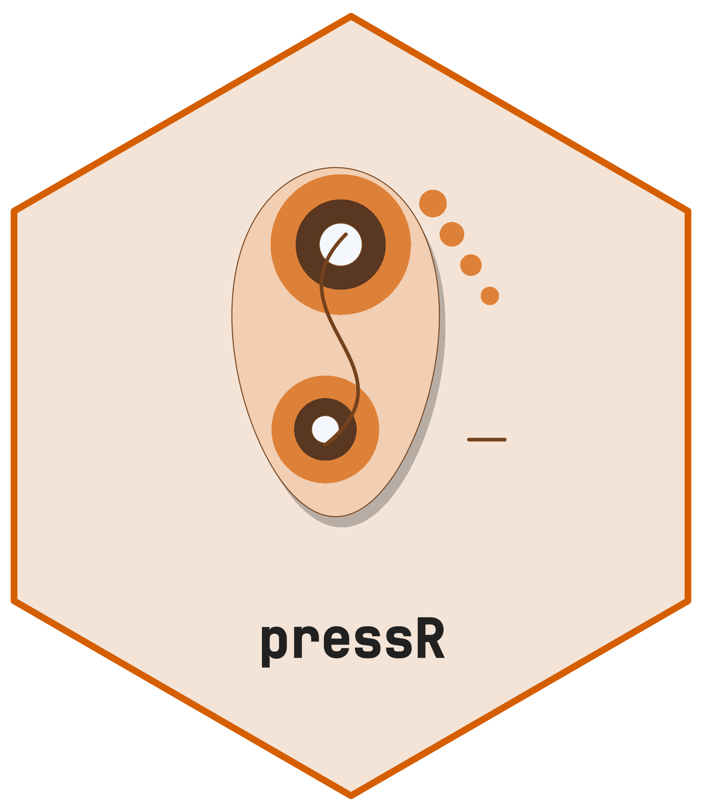

# pressR <picture class="cttir-readme-logo"><source class="cttir-logo-dark-source" media="(prefers-color-scheme: dark)" srcset="man/figures/logo-with-name-dark.png" /></picture>

<!-- badges: start -->
[](https://github.com/CTTIR/pressR/actions/workflows/R-CMD-check.yaml)
[](https://cttir.github.io/pressR/)
[](https://CRAN.R-project.org/package=pressR)
[](https://app.codecov.io/gh/CTTIR/pressR?branch=main)
[](https://cran.r-project.org/package=pressR)
[](https://cran.r-project.org/package=pressR)
[](https://opensource.org/licenses/MIT)
[](https://lifecycle.r-lib.org/articles/stages.html#experimental)
<!-- badges: end -->

**pressR** parses, analyzes, and visualizes pressure distribution data
from capacitive sensor systems. It ships with predefined layouts for
in-shoe pressure measurement, saddle pressure mapping (equine and
bicycle), seating assessment, and barefoot pedography, along with an
interactive Shiny application for data exploration.

## Successor release status

The 0.2.0 development line corrects audited import, unit and reproducibility
problems. The manuscript baseline remains at commit `5f5b370` (0.1.0).
Do not replace a manuscript environment silently: retain its version and saved
cycle references, and review the migration notes in `NEWS.md`.

To reproduce an analysis that used the frozen manuscript baseline, install that
exact source in a separate R library:

```r
baseline_lib <- path.expand("~/R/pressR-manuscript-0.1.0")
dir.create(baseline_lib, recursive = TRUE, showWarnings = FALSE)
pak::pak("CTTIR/pressR@5f5b370890fafae01b78174a1cec52b4a2039ce3",
         lib = baseline_lib)
# In a fresh R session for that manuscript:
.libPaths(c(baseline_lib, .libPaths()))
```
The successor is experimental software; local software checks do not establish
clinical or study-specific validity.

## Installation 

Use R 4.1 or newer. Install the development source and its required dependencies:

```r
install.packages("pak")
pak::pak("cttir/pressR")
```

HTML reports additionally need `rmarkdown` and Pandoc (included with RStudio).
PDF reports also need a LaTeX installation, such as TinyTeX. Workbook and archive
imports respectively need the optional `readxl` and `archive` packages.

```r
install.packages(c("rmarkdown", "tinytex"))  # For HTML and PDF reports
tinytex::install_tinytex()                  # If LaTeX is not already installed
```

## Quick example

```r
library(pressR)

trial <- pr_example_trial("insole")

pr_plot_heatmap(trial)
pr_plot_force_time(trial, show_cycles = TRUE)

pr_summary(trial)
pr_calc_regional(trial)
pr_run_app(trial)  # Opens the interactive explorer
```

## Features

* **Parsers** for ASCII pressure data exports, generic CSV, force
  sensor data, and region mask files (`.msa`/`.msr`/`.msp`).
* **Predefined layouts** for in-shoe insoles (99-sensor), barefoot
  pressure platforms, generic sensor mats (16x16 / 32x32), horse and
  bicycle saddles, wheelchair / car / office seating, and glove sensors.
* **Per-frame and per-trial analysis**: peak pressure, mean pressure,
  force, contact area, pressure-time integral, center of pressure,
  symmetry index, gait cycle detection, and COP rollover pattern.
* **Application-specific analysis**: saddle bridge and slip detection,
  wheelchair hotspot identification, plantar-pressure regional analysis.
* **Traceable reference observations** with source, study context and status.
  Nyikos (2005) is the source of the six saddle observations; unsupported
  legacy thresholds are withdrawn. Overlays require explicit compatible context.
* **Study assets**: lossless workbook cell retention with normalized HR/RR series,
  image metadata registration, bounded archive extraction and explicit-key links.
* **Interchange**: version 2 trial bundles preserve exact measurements and timing,
  layout, units, factor levels and metadata with SHA-256 integrity checks.
* **Visualization**: 2D and 3D heatmaps, dynamics plots, regional bar
  charts, composite report panels, and side-by-side trial comparison.
* **Shiny app** (`pr_run_app()`) for interactive import, analysis, and
  export.

## Real recordings and reproducibility

```r
trial <- pr_read_auto("recording.asc")
pr_summary_long(trial)  # Values, units, and availability
pr_write_bundle(trial, "recording-bundle")
restored <- pr_read_bundle("recording-bundle")
analysis <- pr_temporal_profile(trial, "corrected")
```

New bundles store authoritative measurements in `measurements.rds` and provide
`pressure.csv` as a nonbinding preview for inspection and exchange. Reading checks
the preview's checksum and structure; analyses use the RDS values. Recreate the
bundle to change measurements. This avoids decimal round-trip changes
that can invalidate measurement-bound cycle references. Version 1 bundles remain
readable, with their original decimal precision limits. Only read bundles from
trusted sources: they contain serialized R objects, and checksums detect
corruption without authenticating the sender.

CSV and report exports refuse recorded source paths and symbolic-link targets.
They finish writing before replacing an existing output and restore it after a
reported replacement failure, or report the retained backup path if restoration
fails. These guarantees do not cover process termination or simultaneous writers.

Pliance detection uses the file header, including temporary upload paths. CSV
round trips recognize exported timestamps and sensor identifiers. Incomplete or
malformed generic inputs are rejected instead of padded, truncated or zero-filled.
Pliance missing-frame handling is explicit and recorded in metadata.

Numeric text imports accept nonzero magnitudes from `1e-290` through `1e290`
and check for gross conversion errors. These checks add parsing time: one
synthetic 10,000-frame, 256-sensor CSV took 6.59 seconds versus 0.72 seconds in
the preserved baseline on the audit machine, with identical imported values.
This single fixture is not a general performance guarantee. Version 2 bundles
preserve finite binary measurements beyond that text-import range.

Unknown sensor area or pitch stays unknown. Novel saddle recordings display in
grid units; physical force and contact area remain unavailable until calibrated.
Force-sensor inputs already measured in newtons are summed directly. Negative
sensor offsets are retained and counted for review.

`pr_temporal_profile()` offers `corrected`, `legacy_method`, and `reference`.
Corrected analysis uses measured timing and deterministic plateau handling.
Legacy method retains the historical 50 Hz assumptions but is not an exact replay
guarantee. Use `pr_lock_cycles(trial, saved_cycles)` for measurement-bound reference
replay. Reports do not silently substitute historical results or enable reference
overlays.

`pr_inventory()` retains every source path and flags identical content.
`pr_link_assets()` requires explicit acquisition keys and rejects ambiguous joins.
`pr_read_workbook()` preserves all sheets, row and column provenance, separate
side-by-side HR series, and invalid observations. Numeric time units require an
explicit choice. `pr_read_asset()` registers images; it never converts display
colours to temperatures. Metadata inspection uses ExifTool when installed.

HTML reports require **rmarkdown** and Pandoc; PDF reports additionally require a
working TeX installation. Workbook and archive importers require **readxl** and
**archive**, respectively. The Shiny upload limit defaults to 128 MiB and can be
set through `options(pressR.max_upload_bytes = ...)` before launching the app.

## Vignettes

* `vignette("getting-started", package = "pressR")`
* `vignette("saddle-pressure-analysis", package = "pressR")`
* `vignette("foot-pressure-analysis", package = "pressR")`

## License

MIT

## Citation

Use `citation("pressR")` for the installed version. Record the package version and
source commit with each analysis. The previously advertised Zenodo identifier is
a draft identifier that does not currently resolve; it is not presented as a
published release DOI.

## Use of LLM tools

Where applicable, LLM tools were used for narrowly defined, non-authorial tasks:
copyediting, prose refinement, Markdown/LaTeX formatting, boilerplate scaffolding
(such as CI configurations and build scripts), and code refactoring. Tools included
[Chat AI](https://kisski.gwdg.de/leistungen/2-02-llm-service/), the KISSKI
(GWDG) service, and self-hosted **Mistral Small (24B, Apache-2.0)** served through
a local **vLLM architecture** on an Ubuntu Linux workstation with Intel
processors and NVIDIA GPUs. The self-hosted model ran locally, with no data sent
to third parties.

All scientific claims, methodological choices, analyses, interpretations and
conclusions remain the authors' own. Where applicable, LLM-generated material
must be reviewed and revised before inclusion, and references must be verified
against their DOI, arXiv ID or ISBN.

Local software setup: vLLM with Python/PyTorch, plus R and RStudio.

## Branding

Editable R artwork and regeneration instructions are in [tools/branding](https://github.com/CTTIR/pressR/blob/main/tools/branding/README.md).
