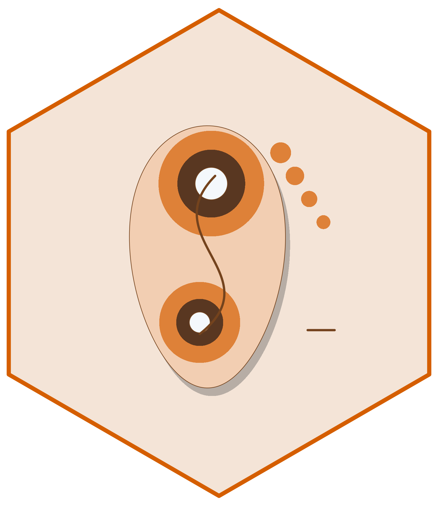

# pressR 

[](https://doi.org/10.5281/zenodo.21889954)

<!-- badges: start -->
[](https://github.com/CTTIR/pressR/actions/workflows/R-CMD-check.yaml)
[](https://cttir.github.io/pressR/)
[](https://CRAN.R-project.org/package=pressR)
[](https://app.codecov.io/gh/CTTIR/pressR?branch=main)
[](https://cran.r-project.org/package=pressR)
[](https://cran.r-project.org/package=pressR)
[](https://opensource.org/licenses/MIT)
[](https://lifecycle.r-lib.org/articles/stages.html#experimental)
<!-- badges: end -->

**pressR** parses, analyzes, and visualizes pressure distribution data
from capacitive sensor systems. It ships with predefined layouts for
in-shoe pressure measurement, saddle pressure mapping (equine and
bicycle), seating assessment, and barefoot pedography, along with an
interactive Shiny application for data exploration.

## Installation 

```r
# install.packages("pak")
pak::pak("cttir/pressR")
```

## Quick example

```r
library(pressR)

trial <- pr_example_trial("insole")

pr_plot_heatmap(trial)
pr_plot_force_time(trial, show_cycles = TRUE)

pr_summary(trial)
pr_calc_regional(trial)
```

## Features

* **Parsers** for ASCII pressure data exports, generic CSV, force
  sensor data, and region mask files (`.msa`/`.msr`/`.msp`).
* **Predefined layouts** for in-shoe insoles (99-sensor), barefoot
  pressure platforms, generic sensor mats (16x16 / 32x32), horse and
  bicycle saddles, wheelchair / car / office seating, and glove sensors.
* **Per-frame and per-trial analysis**: peak pressure, mean pressure,
  force, contact area, pressure-time integral, center of pressure,
  symmetry index, gait cycle detection, and COP rollover pattern.
* **Application-specific analysis**: saddle bridge and slip detection,
  wheelchair hotspot identification, plantar-pressure regional analysis.
* **Published reference thresholds** for saddle fit (von Peinen 2010,
  Moenkemoeller 2005, Werner 2002), diabetic foot risk, and wheelchair
  seating.
* **Visualization**: 2D and 3D heatmaps, dynamics plots, regional bar
  charts, composite report panels, and side-by-side trial comparison.
* **Shiny app** (`pr_run_app()`) for interactive import, analysis, and
  export.

## Vignettes

* `vignette("getting-started", package = "pressR")`
* `vignette("saddle-pressure-analysis", package = "pressR")`
* `vignette("foot-pressure-analysis", package = "pressR")`

## License

MIT

## Citation

If you use this software, please cite it as:

> Heller, R. (2026). *pressR: Pressure distribution analysis for capacitive sensor systems* (Version 0.1.0) [Computer software]. Zenodo. https://doi.org/10.5281/zenodo.21889954

DOI: [10.5281/zenodo.21889954](https://doi.org/10.5281/zenodo.21889954)

## Use of LLM tools

Where applicable, LLM tools were used for narrowly defined, non-authorial tasks:
copyediting, prose refinement, Markdown/LaTeX formatting, boilerplate scaffolding
(such as CI configurations and build scripts), and code refactoring. Tools included [Chat AI](https://kisski.gwdg.de/leistungen/2-02-llm-service/), the KISSKI
(GWDG) service, and self-hosted **Mistral Small (24B, Apache-2.0)** served through
a local **vLLM architecture** on an Ubuntu Linux workstation with Intel
processors and NVIDIA GPUs. The self-hosted model ran locally, with no data sent
to third parties. Maintainers remain responsible for review, validation and
the final content.
