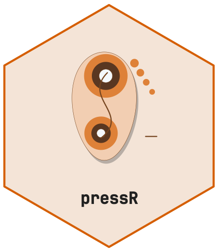
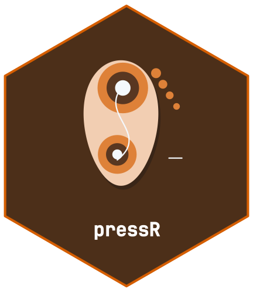

# Equine Saddle Pressure Analysis with pressR



[](https://github.com/CTTIR/pressR/actions/workflows/R-CMD-check.yaml)
[](https://cttir.github.io/pressR/)
[](https://app.codecov.io/gh/CTTIR/pressR?branch=main)
[](https://opensource.org/licenses/MIT)
[](https://lifecycle.r-lib.org/articles/stages.html#experimental)

``` r

library(pressR)
```

This vignette demonstrates descriptive saddle-pressure analysis using
synthetic measurements. Source-specific observations are not universal
diagnostic limits.

## Load the saddle layout

``` r

layout <- pr_layout_saddle("horse")
names(layout$regions)
#> [1] "cranial_left"  "cranial_right" "middle_left"   "middle_right" 
#> [5] "caudal_left"   "caudal_right"
```

## Load a synthetic trial

``` r

trial <- pr_example_trial("saddle_horse")
trial
#> 
#> ── pr_trial ────────────────────────────────────────────────────────────────────
#> • System: "saddle_mat"
#> • Layout: "saddle_horse"
#> • Frames: 500
#> • Duration: 9.98 s
#> • Sampling: 50 Hz
#> • Sensors: 248
#> • Subject: "HORSE01"
#> • Date: "2026-11-10"
#> • Condition: "walk"
```

## Inspect the pressure map

``` r

pr_plot_heatmap_masked(trial)
```


## Regional analysis

``` r

masks <- pr_mask_saddle_6(layout)
reg <- pr_calc_regional(trial, masks)
reg
#> # A tibble: 6 × 6
#>   region          mpp   mvp max_force contact_area pti_mean
#>   <chr>         <dbl> <dbl>     <dbl>        <dbl>    <dbl>
#> 1 cranial_left   18.2  2.41     105.           320     17.7
#> 2 cranial_right  16.5  2.13      94.5          320     15.4
#> 3 middle_left    11.9  1.71      84.1          370     12.7
#> 4 middle_right   10.5  1.53      72.6          370     11.2
#> 5 caudal_left    18.3  2.03     113.           430     14.4
#> 6 caudal_right   15.4  1.80      98.5          410     12.6
```

``` r

pr_plot_regional_bar(reg, "mvp")
```


## Bridge detection

``` r

bridge <- pr_calc_saddle_bridge(trial)
bridge
#> 
#> ── Saddle Bridge Analysis ──
#> 
#> • Bridge ratio: 0.774
#> • Bridging: FALSE
#> Pressure distribution appears continuous across the saddle (ratio = 0.77).
```

## Slip / asymmetric loading

``` r

slip <- pr_calc_saddle_slip(trial)
slip$symmetry_index_mean
#> [1] 10.97179
slip$dominant_side
#> [1] "balanced"
```

## Composite report

``` r

pr_plot_saddle_report(trial)
```


## Reference context and reproducibility

[`pr_ref_saddle()`](https://cttir.github.io/pressR/reference/pr_ref_saddle.md)
now attributes the six source observations to Nyikos (2005). An overlay
requires matching species, gait and mask definitions recorded in
`trial$metadata$reference_context`; synthetic examples do not establish
that context. Unsupported legacy numeric entries are withdrawn.

Novel Pliance files are detected by their header, including files with a
temporary upload name. The Novel layout retains grid coordinates and
unknown sensor area: force, physical contact area and millimetre
distances cannot be inferred.
[`pr_summary_long()`](https://cttir.github.io/pressR/reference/pr_summary_long.md)
states units and availability explicitly.

Use `pr_temporal_profile(trial, "corrected")` for measured sampling and
stable plateau handling. `legacy_method` repeats the historical 50 Hz
assumptions but cannot guarantee identical cycles across numerical
environments. Exact historical cycles must be bound to the recording
with
[`pr_lock_cycles()`](https://cttir.github.io/pressR/reference/pr_lock_cycles.md)
and replayed with
`pr_temporal_profile(trial, "reference", locked_cycles)`. Reference
phase maps use the central 80 percent of saved cycles and an untrimmed
mean.

## Source

Nyikos S, et al. (2005). *Pferdeheilkunde* 21:187-198, abstract p.187.
[Original article](https://pferdeheilkunde.de/files/20050301.pdf).
