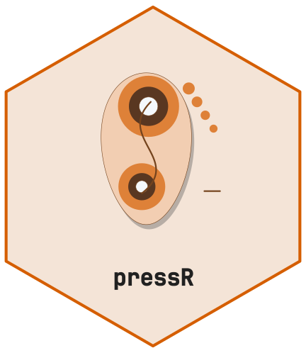

# Foot Pressure Analysis for Pedography and Gait Assessment



[](https://github.com/CTTIR/pressR/actions/workflows/R-CMD-check.yaml)
[](https://cttir.github.io/pressR/)
[](https://CRAN.R-project.org/package=pressR)
[](https://app.codecov.io/gh/CTTIR/pressR?branch=main)
[](https://cran.r-project.org/package=pressR)
[](https://cran.r-project.org/package=pressR)
[](https://opensource.org/licenses/MIT)
[](https://lifecycle.r-lib.org/articles/stages.html#experimental)

``` r

library(pressR)
```

Plantar-pressure measurement is used in pedography, gait analysis, and
diabetic-foot risk assessment. This vignette demonstrates the workflow
using a synthetic in-shoe insole trial.

``` r

trial <- pr_example_trial("insole")
trial
#> 
#> ── pr_trial ────────────────────────────────────────────────────────────────────
#> • System: "insole"
#> • Layout: "insole_standard"
#> • Frames: 250
#> • Duration: 4.98 s
#> • Sampling: 50 Hz
#> • Sensors: 99
#> • Subject: "EX01"
#> • Date: "2026-11-09"
#> • Condition: "walking"
```

## Gait cycle detection

``` r

cycles <- pr_calc_gait_cycles(trial)
cycles
#> # A tibble: 5 × 8
#>   cycle heel_strike_frame toe_off_frame heel_strike_time toe_off_time
#>   <int>             <int>         <int>            <dbl>        <dbl>
#> 1     1                 1            31                0         0.6 
#> 2     2                51            80                1         1.58
#> 3     3               101           130                2         2.58
#> 4     4               151           180                3         3.58
#> 5     5               201           231                4         4.6 
#> # ℹ 3 more variables: stance_duration <dbl>, start_frame <int>, end_frame <int>
```

## Force vs time with cycles

``` r

pr_plot_force_time(trial, show_cycles = TRUE)
```


## Center of pressure and rollover

``` r

pr_plot_cop(trial)
```


``` r

pr_plot_cop_butterfly(trial)
```


## Regional analysis

``` r

pr_calc_regional(trial)
#> # A tibble: 7 × 6
#>   region           mpp   mvp max_force contact_area pti_mean
#>   <chr>          <dbl> <dbl>     <dbl>        <dbl>    <dbl>
#> 1 heel            219.  15.0     349.          42       40.3
#> 2 midfoot         643.  59.5    1234.          61.5    155. 
#> 3 metatarsal_1    127.  23.0      41.7          6       65.1
#> 4 metatarsal_2_3  215.  43.0     113.           9      126. 
#> 5 metatarsal_4_5  135.  16.0      48.5          9       43.9
#> 6 hallux          258.  29.4     118.           6       82.5
#> 7 lesser_toes     190.  12.7      71.8         12       29.6
```

## Plantar-pressure reference observations

These source-specific observations are not universal clinical cut-offs.
The synthetic insole example does not establish equivalent acquisition
or patient context. Rows marked withdrawn have no verified numeric
value.

``` r

pr_ref_diabetic_foot()
#> # A tibble: 4 × 11
#>   region      parameter threshold unit  interpretation  source source_url status
#>   <chr>       <chr>         <dbl> <chr> <chr>           <chr>  <chr>      <chr> 
#> 1 forefoot    mpp             700 kPa   Case-control R… Armst… https://p… verif…
#> 2 any plantar pti_mean         NA kPa*s Withdrawn: exa… Casel… NA         withd…
#> 3 forefoot    mpp              NA kPa   Withdrawn: exa… Veves… NA         withd…
#> 4 heel        mpp              NA kPa   Withdrawn: exa… Frykb… NA         withd…
#> # ℹ 3 more variables: species <chr>, gait <chr>, region_scheme <chr>
```

## Composite foot report

[`pr_plot_foot_report()`](https://cttir.github.io/pressR/dev/reference/pr_plot_foot_report.md)
returns four component plots. Display them separately here so labels and
legends remain readable at the article width. The HTML/PDF report from
`pr_export_report(trial, path, template = "foot")` uses these same
components.

``` r

panels <- pr_plot_foot_report(trial)
panels[[1]]
```


``` r

panels[[2]]
```


``` r

panels[[3]]
```


``` r

panels[[4]]
```


