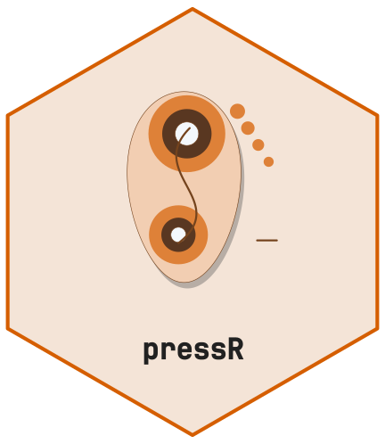

# Getting Started with pressR



[](https://github.com/CTTIR/pressR/actions/workflows/R-CMD-check.yaml)
[](https://cttir.github.io/pressR/)
[](https://CRAN.R-project.org/package=pressR)
[](https://app.codecov.io/gh/CTTIR/pressR?branch=main)
[](https://cran.r-project.org/package=pressR)
[](https://cran.r-project.org/package=pressR)
[](https://opensource.org/licenses/MIT)
[](https://lifecycle.r-lib.org/articles/stages.html#experimental)

``` r

library(pressR)
```

## What pressR does

**pressR** parses, analyzes, and visualizes pressure distribution data
from capacitive sensor systems. It provides:

- Predefined sensor layouts (in-shoe insoles, pressure platforms, saddle
  mats, seating mats, glove sensors),
- Parsers for ASCII and CSV pressure data files,
- A full analysis pipeline (per-frame metrics, trial summaries, regional
  analysis, gait-cycle detection, saddle-fit checks),
- `ggplot2`-based visualization and composite reports,
- An interactive Shiny application for data exploration.

## Load a layout

Every trial is tied to a `pr_layout` object that describes the sensor
geometry. For example, a 99-sensor in-shoe pressure insole:

``` r

layout <- pr_layout_insole()
print(layout)
#> 
#> ── pr_layout: insole_standard ──────────────────────────────────────────────────
#> In-shoe pressure insole (99 sensors, standard).
#> • Manufacturer: ""
#> • Model: "insole"
#> • Grid: 18 x 8
#> • Active sensors: 99
#> • Sensor area: 1.5 cm²
#> • Pressure range: 0 - 1200 kPa
#> • Regions: 7
#> Region names: "heel", "midfoot", "metatarsal_1", "metatarsal_2_3",
#> "metatarsal_4_5", "hallux", and "lesser_toes"
```

## Generate a synthetic example trial

[`pr_example_trial()`](https://cttir.github.io/pressR/dev/reference/pr_example_trial.md)
produces realistic synthetic data for each supported application. This
is useful for quick demos, tests, and vignettes.

``` r

trial <- pr_example_trial("insole")
trial
#> 
#> ── pr_trial ────────────────────────────────────────────────────────────────────
#> • System: "insole"
#> • Layout: "insole_standard"
#> • Frames: 250
#> • Duration: 4.98 s
#> • Sampling: 50 Hz
#> • Sensors: 99
#> • Subject: "EX01"
#> • Date: "2026-11-04"
#> • Condition: "walking"
```

## Visualize

The default plot method draws a maximum-pressure picture (MPP):

``` r

pr_plot_heatmap(trial)
```


Time-domain curves are equally straightforward:

``` r

pr_plot_force_time(trial, show_cycles = TRUE)
```


## Summarize

[`pr_summary()`](https://cttir.github.io/pressR/dev/reference/pr_summary.md)
returns a single-row tibble containing the common biomechanical
parameters:

``` r

pr_summary(trial)
#> # A tibble: 1 × 14
#>     mpp   mvp max_force mean_force max_contact_area mean_contact_area
#>   <dbl> <dbl>     <dbl>      <dbl>            <dbl>             <dbl>
#> 1  643.  43.0     1442.       290.             128.              61.1
#> # ℹ 8 more variables: contact_time <dbl>, pti_max <dbl>, pti_mean <dbl>,
#> #   impulse <dbl>, cop_path_length <dbl>, cop_velocity_mean <dbl>,
#> #   cop_range_ap <dbl>, cop_range_ml <dbl>
```

## Regional analysis

With the insole layout’s default region masks you get one row per
anatomical region:

``` r

pr_calc_regional(trial)
#> # A tibble: 7 × 6
#>   region           mpp   mvp max_force contact_area pti_mean
#>   <chr>          <dbl> <dbl>     <dbl>        <dbl>    <dbl>
#> 1 heel            219.  15.0     349.          42       40.3
#> 2 midfoot         643.  59.5    1234.          61.5    155. 
#> 3 metatarsal_1    127.  23.0      41.7          6       65.1
#> 4 metatarsal_2_3  215.  43.0     113.           9      126. 
#> 5 metatarsal_4_5  135.  16.0      48.5          9       43.9
#> 6 hallux          258.  29.4     118.           6       82.5
#> 7 lesser_toes     190.  12.7      71.8         12       29.6
```

## Export

Results can be exported as CSV:

``` r

tmp <- tempfile(fileext = ".csv")
pr_export_csv(trial, tmp, what = "summary")
```

## Launch the Shiny app

``` r

pr_run_app(trial)
```

The seven tabs cover import, maps, regions, dynamics, temporal analysis,
comparison, and export. Examples are synthetic. Choose masks in Regions
before exporting regional results or a report. An invalid replacement
clears the recording and its derived results; load a valid recording or
example to recover.

HTML reports need `rmarkdown` and Pandoc; PDF additionally needs LaTeX.
Failed exports show an error in the app and do not return a completed
report.

Pressure CSV is a measurement table: it omits the layout, physical
calibration, and typed metadata. Re-import it with the correct layout in
R. For an exact, self-contained roundtrip, use
`pr_write_bundle(trial, new_directory)` and
`pr_read_bundle(new_directory)` instead. Unknown physical quantities
remain unavailable; generic channel-count layout inference is not
evidence of calibration.
