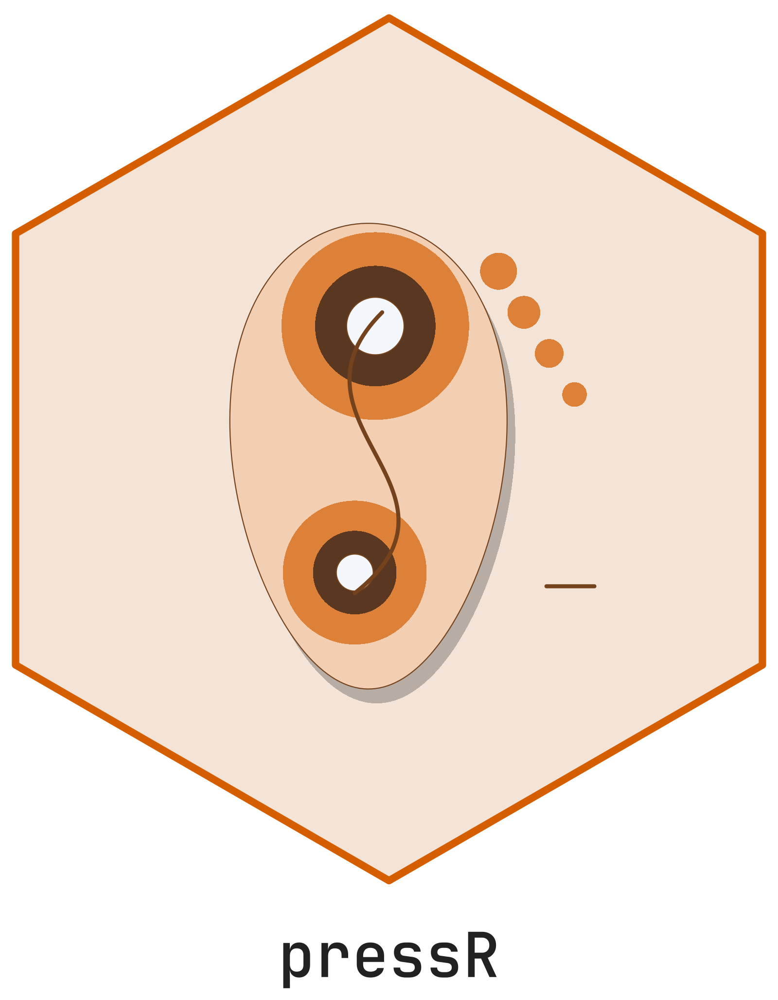

# pressR 

[](https://doi.org/10.5281/zenodo.21889954)

**pressR** parses, analyzes, and visualizes pressure distribution data
from capacitive sensor systems. It ships with predefined layouts for
in-shoe pressure measurement, saddle pressure mapping (equine and
bicycle), seating assessment, and barefoot pedography, along with an
interactive Shiny application for data exploration.

## Installation

``` r

# install.packages("pak")
pak::pak("cttir/pressR")
```

## Quick example

``` r

library(pressR)

trial <- pr_example_trial("insole")

pr_plot_heatmap(trial)
pr_plot_force_time(trial, show_cycles = TRUE)

pr_summary(trial)
pr_calc_regional(trial)
```

## Features

- **Parsers** for ASCII pressure data exports, generic CSV, force sensor
  data, and region mask files (`.msa`/`.msr`/`.msp`).
- **Predefined layouts** for in-shoe insoles (99-sensor), barefoot
  pressure platforms, generic sensor mats (16x16 / 32x32), horse and
  bicycle saddles, wheelchair / car / office seating, and glove sensors.
- **Per-frame and per-trial analysis**: peak pressure, mean pressure,
  force, contact area, pressure-time integral, center of pressure,
  symmetry index, gait cycle detection, and COP rollover pattern.
- **Application-specific analysis**: saddle bridge and slip detection,
  wheelchair hotspot identification, plantar-pressure regional analysis.
- **Published reference thresholds** for saddle fit (von Peinen 2010,
  Moenkemoeller 2005, Werner 2002), diabetic foot risk, and wheelchair
  seating.
- **Visualization**: 2D and 3D heatmaps, dynamics plots, regional bar
  charts, composite report panels, and side-by-side trial comparison.
- **Shiny app**
  ([`pr_run_app()`](https://cttir.github.io/pressR/reference/pr_run_app.md))
  for interactive import, analysis, and export.

## Vignettes

- [`vignette("getting-started", package = "pressR")`](https://cttir.github.io/pressR/articles/getting-started.md)
- [`vignette("saddle-pressure-analysis", package = "pressR")`](https://cttir.github.io/pressR/articles/saddle-pressure-analysis.md)
- [`vignette("foot-pressure-analysis", package = "pressR")`](https://cttir.github.io/pressR/articles/foot-pressure-analysis.md)

## License

MIT

## Citation

If you use this software, please cite it as:

> Heller, R. (2026). *pressR: Pressure distribution analysis for
> capacitive sensor systems* (Version 0.1.0) \[Computer software\].
> Zenodo. <https://doi.org/10.5281/zenodo.21889954>

DOI: [10.5281/zenodo.21889954](https://doi.org/10.5281/zenodo.21889954)

## Use of LLM tools

Where applicable, LLM tools were used for narrowly defined,
non-authorial tasks: copyediting, prose refinement, Markdown/LaTeX
formatting, boilerplate scaffolding (such as CI configurations and build
scripts), and code refactoring. Tools included [Chat
AI](https://kisski.gwdg.de/leistungen/2-02-llm-service/), the KISSKI
(GWDG) service, and self-hosted **Mistral Small (24B, Apache-2.0)**
served through a local **vLLM architecture** on an Ubuntu Linux
workstation with Intel processors and NVIDIA GPUs. The self-hosted model
ran locally, with no data sent to third parties.

All scientific claims, methodological choices, analyses, interpretations
and conclusions remain the authors’ own. Where applicable, LLM-generated
material must be reviewed and revised before inclusion, and references
must be verified against their DOI, arXiv ID or ISBN.

Local software setup: vLLM with Python/PyTorch, plus R and RStudio.

## Branding

Editable R artwork and regeneration instructions are in
[tools/branding](https://github.com/CTTIR/pressR/blob/main/tools/branding/README.md).
