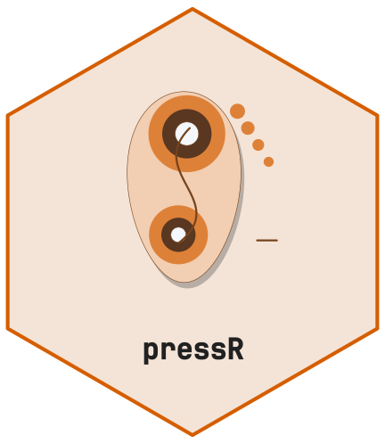
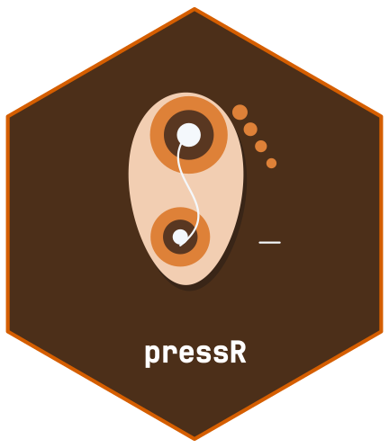

<!-- cttir-vignette-logo: start -->
<style>
.cttir-vignette-logo { float: right; width: 120px; max-width: 30%; margin: 0 0 1rem 1.5rem; }
.cttir-vignette-logo img { width: 100%; height: auto; border: 0; background: transparent; box-shadow: none; }
.cttir-vignette-logo .cttir-vignette-logo-light { display: block; }
.cttir-vignette-logo .cttir-vignette-logo-dark { display: none; }
@media (prefers-color-scheme: dark) {
  .cttir-vignette-logo .cttir-vignette-logo-light { display: none; }
  .cttir-vignette-logo .cttir-vignette-logo-dark { display: block; }
}
[data-bs-theme="light"] .cttir-vignette-logo .cttir-vignette-logo-light { display: block; }
[data-bs-theme="light"] .cttir-vignette-logo .cttir-vignette-logo-dark { display: none; }
[data-bs-theme="dark"] .cttir-vignette-logo .cttir-vignette-logo-light { display: none; }
[data-bs-theme="dark"] .cttir-vignette-logo .cttir-vignette-logo-dark { display: block; }
</style>
<div class="cttir-vignette-logo">
  
  
</div>
<!-- cttir-vignette-logo: end -->

<!-- badges: start -->
[](https://github.com/CTTIR/pressR/actions/workflows/R-CMD-check.yaml)
[](https://cttir.github.io/pressR/)
[](https://CRAN.R-project.org/package=pressR)
[](https://app.codecov.io/gh/CTTIR/pressR?branch=main)
[](https://cran.r-project.org/package=pressR)
[](https://cran.r-project.org/package=pressR)
[](https://opensource.org/licenses/MIT)
[](https://lifecycle.r-lib.org/articles/stages.html#experimental)
<!-- badges: end -->

```{r, include = FALSE}
knitr::opts_chunk$set(
  collapse = TRUE, comment = "#>",
  fig.width = 7, fig.height = 4.5, dpi = 96
)
```

```{r setup, message=FALSE}
library(pressR)
```

Plantar-pressure measurement is used in pedography, gait analysis, and
diabetic-foot risk assessment. This vignette demonstrates the workflow
using a synthetic in-shoe insole trial.

```{r}
trial <- pr_example_trial("insole")
trial
```

## Gait cycle detection

```{r}
cycles <- pr_calc_gait_cycles(trial)
cycles
```

## Force vs time with cycles

```{r, fig.alt="Force vs time with stance phases shaded"}
pr_plot_force_time(trial, show_cycles = TRUE)
```

## Center of pressure and rollover

```{r, fig.alt="COP trajectory over time"}
pr_plot_cop(trial)
```

```{r, fig.alt="COP butterfly across cycles"}
pr_plot_cop_butterfly(trial)
```

## Regional analysis

```{r}
pr_calc_regional(trial)
```

## Diabetic foot thresholds

```{r}
pr_ref_diabetic_foot()
```

## Composite foot report

```{r, fig.alt="Foot-pressure composite report", fig.width=9, fig.height=7}
pr_plot_foot_report(trial)
```
