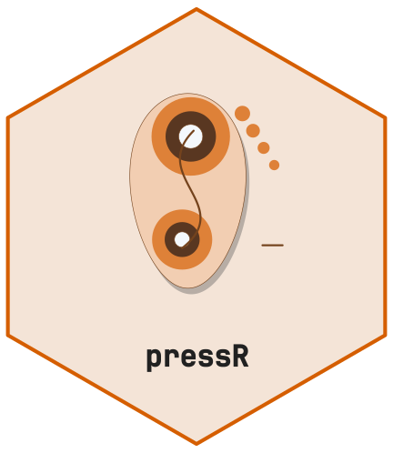
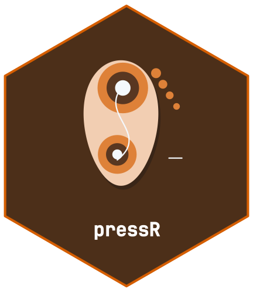

<!-- cttir-vignette-logo: start -->
<style>
.cttir-vignette-logo { float: right; width: 120px; max-width: 30%; margin: 0 0 1rem 1.5rem; }
.cttir-vignette-logo img { width: 100%; height: auto; border: 0; background: transparent; box-shadow: none; }
.cttir-vignette-logo .cttir-vignette-logo-light { display: block; }
.cttir-vignette-logo .cttir-vignette-logo-dark { display: none; }
@media (prefers-color-scheme: dark) {
  .cttir-vignette-logo .cttir-vignette-logo-light { display: none; }
  .cttir-vignette-logo .cttir-vignette-logo-dark { display: block; }
}
[data-bs-theme="light"] .cttir-vignette-logo .cttir-vignette-logo-light { display: block; }
[data-bs-theme="light"] .cttir-vignette-logo .cttir-vignette-logo-dark { display: none; }
[data-bs-theme="dark"] .cttir-vignette-logo .cttir-vignette-logo-light { display: none; }
[data-bs-theme="dark"] .cttir-vignette-logo .cttir-vignette-logo-dark { display: block; }
</style>
<div class="cttir-vignette-logo">
  
  
</div>
<!-- cttir-vignette-logo: end -->

<!-- badges: start -->
[](https://github.com/CTTIR/pressR/actions/workflows/R-CMD-check.yaml)
[](https://cttir.github.io/pressR/)
[](https://CRAN.R-project.org/package=pressR)
[](https://app.codecov.io/gh/CTTIR/pressR?branch=main)
[](https://cran.r-project.org/package=pressR)
[](https://cran.r-project.org/package=pressR)
[](https://opensource.org/licenses/MIT)
[](https://lifecycle.r-lib.org/articles/stages.html#experimental)
<!-- badges: end -->

```{r, include = FALSE}
knitr::opts_chunk$set(
  collapse = TRUE, comment = "#>",
  fig.width = 7, fig.height = 5, dpi = 96
)
```

```{r setup, message=FALSE}
library(pressR)
```

This vignette demonstrates descriptive saddle-pressure analysis using synthetic
measurements. Source-specific observations are not universal diagnostic limits.

## Load the saddle layout

```{r}
layout <- pr_layout_saddle("horse")
names(layout$regions)
```

## Load a synthetic trial

```{r}
trial <- pr_example_trial("saddle_horse")
trial
```

## Inspect the pressure map

```{r, fig.alt="Saddle pressure heatmap with 6-region mask"}
pr_plot_heatmap_masked(trial)
```

## Regional analysis

```{r}
masks <- pr_mask_saddle_6(layout)
reg <- pr_calc_regional(trial, masks)
reg
```

```{r, fig.alt="Regional mean-pressure bar chart"}
pr_plot_regional_bar(reg, "mvp")
```

## Bridge detection

```{r}
bridge <- pr_calc_saddle_bridge(trial)
bridge
```

## Slip / asymmetric loading

```{r}
slip <- pr_calc_saddle_slip(trial)
slip$symmetry_index_mean
slip$dominant_side
```

## Composite report

```{r, fig.alt="Saddle-fit composite report", fig.width=9, fig.height=7}
pr_plot_saddle_report(trial)
```

## Reference context and reproducibility

`pr_ref_saddle()` now attributes the six source observations to Nyikos (2005).
An overlay requires matching species, gait and mask definitions recorded in
`trial$metadata$reference_context`; synthetic examples do not establish that
context. Unsupported legacy numeric entries are withdrawn.

Novel Pliance files are detected by their header, including files with a temporary
upload name. The Novel layout retains grid coordinates and unknown sensor area:
force, physical contact area and millimetre distances cannot be inferred.
`pr_summary_long()` states units and availability explicitly.

Use `pr_temporal_profile(trial, "corrected")` for measured sampling and stable
plateau handling. `legacy_method` repeats the historical 50 Hz assumptions but
cannot guarantee identical cycles across numerical environments. Exact historical
cycles must be bound to the recording with `pr_lock_cycles()` and replayed with
`pr_temporal_profile(trial, "reference", locked_cycles)`. Reference phase maps
use the central 80 percent of saved cycles and an untrimmed mean.

## Source

Nyikos S, et al. (2005). *Pferdeheilkunde* 21:187-198, abstract p.187.
[Original article](https://pferdeheilkunde.de/files/20050301.pdf).
